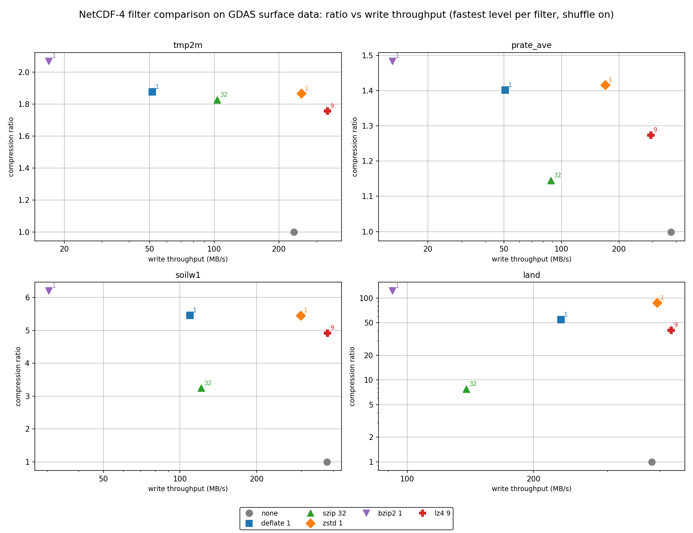
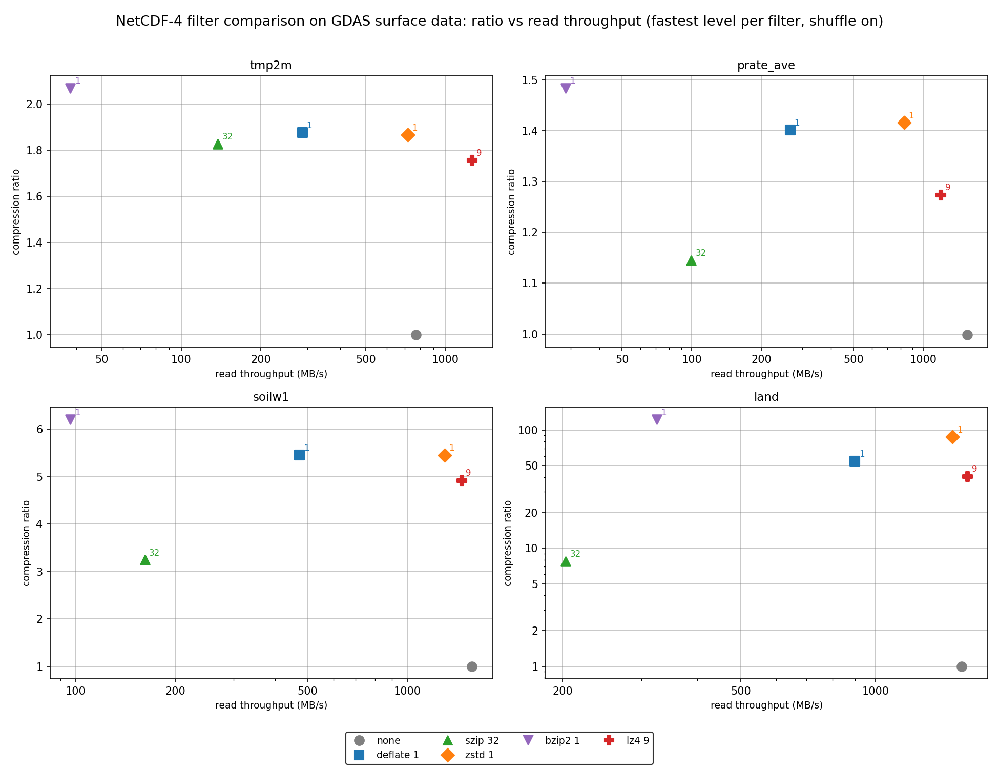
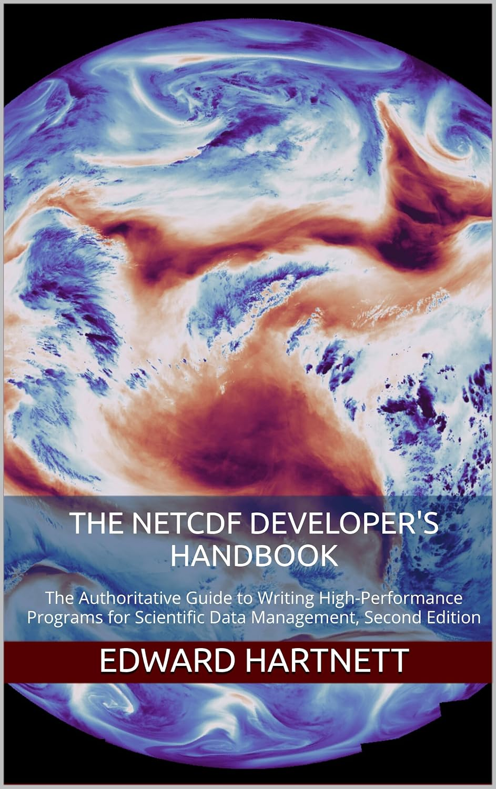
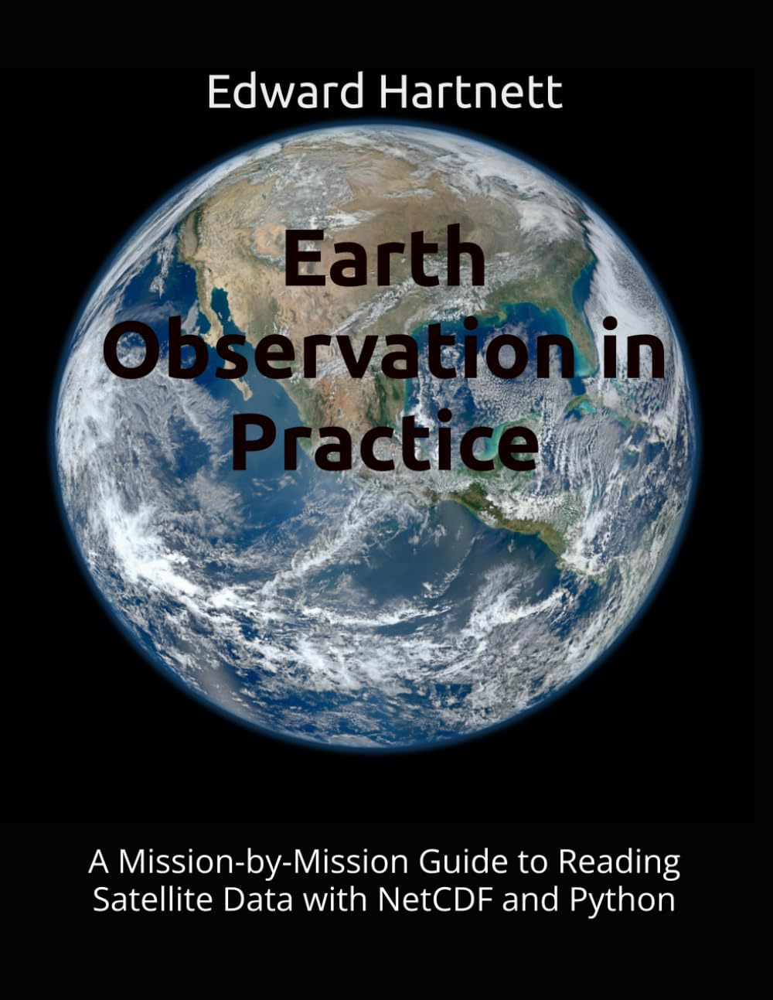

# nep-compress

nep-compress contains additional compression filters for netCDF.

## Compression Filters in nep-compress

nep-compress supports the following additional compression filters for netCDF:
* LZ4 - not as compressive as zstd, but blazing fast,
causing almost no addition delay when writing or reading data.
* JPEG-LS - EUMETSAT's FCIDECOMP filter (ID 32018), used for Meteosat
FCI Level-1c imagery; requires an external plugin (fcidecomp or
hdf5plugin) and works on 8- and 16-bit integer data.

## Provenence of nep-compress

nep-compress contains code which was previously part of the [NetCDF
Expansion Pack
(NEP)](https://github.com/Intelligent-Data-Design-Inc/NEP) to make
compression easier to build and use.

The NEP allows users to access additional format with netCDF tools and
programs. Earth science formats like GeoTIFF and GRIB2, but also space
science formats CDF, FITS, and PDS 3/4, as well as medical images and
protien folding database formats. See the project website for more info.

## Implementation Details

nep-compress **builds an LZ4 HDF5 plugin** (`libh5lz4.so`, filter ID 32004).
The plugin source is the HDF Group hdf5_plugins LZ4 filter, vendored
unchanged; see [plugins/README.md](plugins/README.md) for provenance.
For BZIP2 (ID 307), it builds the C/Fortran API but requires a compatible
**external HDF5 BZIP2 plugin** for both writing and reading. `libbz2` alone
is not a plugin. BZIP2 is OFF by default. For JPEG-LS (ID 32018), it builds
the C/Fortran API and likewise requires an **external JPEG-LS plugin**
(EUMETSAT fcidecomp or hdf5plugin); JPEG-LS is also OFF by default.

**Documentation:** https://captainkirk99.github.io/nep-compress/

**Extended abstract:** [docs/nep-compress-abstract.md](docs/nep-compress-abstract.md)

## Performance

The `perf_compare_filters` test rewrites four real GDAS surface fields
(`tmp2m`, `prate_ave`, `soilw1`, `land`) with every lossless NetCDF-4
filter and measures compression ratio and end-to-end write and read
throughput. The charts below show one setting per filter with shuffle
on: for each filter, the level with the highest mean write throughput
(deflate 1, zstd 1, bzip2 1, LZ4 9, szip 32). Top right is best. The
x axis is logarithmic, and so is the y axis for `land`.



**Figure 1.** Compression ratio vs write throughput, fastest level of
each filter, shuffle on. Generated 2026-11-01 with nep-compress 1.2.0,
NetCDF-C 4.10.2-development (`5baa62e69`) and HDF5 2.1.1. The data
for these graphs were generated by
[performance/compare_filters.c](performance/compare_filters.c), a C
program which calls the NetCDF-C library to write and then read a
sample of GDAS surface data, using different compression methods.
They were plotted by
[performance/plot_compare_filters.py](performance/plot_compare_filters.py),
a Python script which uses matplotlib to draw compression ratio
against throughput from that program's CSV output.



**Figure 2.** Compression ratio vs read throughput for the same runs as
Figure 1. Generated 2026-11-01 with nep-compress 1.2.0, NetCDF-C
4.10.2-development (`5baa62e69`) and HDF5 2.1.1. The data for these
graphs were generated by
[performance/compare_filters.c](performance/compare_filters.c), a C
program which calls the NetCDF-C library to write and then read a
sample of GDAS surface data, using different compression methods.
They were plotted by
[performance/plot_compare_filters.py](performance/plot_compare_filters.py),
a Python script which uses matplotlib to draw compression ratio
against throughput from that program's CSV output.

LZ4 was the fastest writer and reader in every field. zstd 1 matched
deflate 1's ratio at 1.7 to 5 times its write speed. bzip2 gave the
highest ratios but was the slowest writer. Results come from one machine (Intel Core
i7-6800K, Linux) and one data set. See
[performance/reference_machine.txt](performance/reference_machine.txt)
for every library version and
[performance/reference_results.csv](performance/reference_results.csv)
for the numbers. The
[documentation](https://captainkirk99.github.io/nep-compress/) has the
full comparison and recommendations, and
[performance/README.md](performance/README.md) explains how to run the
test on your own data.

## Dependencies

- CMake 3.18+, a C compiler, pkg-config, NetCDF-C 4.10.0+ (4.10.1+ for
  the `perf_compare_filters` test), HDF5 1.14+
  with C/HL libraries, and liblz4 when LZ4 is enabled.
- A Fortran compiler and NetCDF-Fortran when `NEPCOMPRESS_ENABLE_FORTRAN=ON`
  (the default). These must use the same NetCDF-C/HDF5 installation.
- For BZIP2, an external HDF5 plugin that implements ID 307 with an
  encoder and decoder; pass its directory to
  `NEPCOMPRESS_BZIP2_PLUGIN_DIR`. The CMake probe fails rather than
  silently skipping enabled BZIP2 coverage.

One provider is a matching HDF5 plugin package (for example a
`hdf5plugin` package installed in the *same* Conda environment as HDF5).
Its plugin directory can be queried with
`python -c 'import hdf5plugin; print(hdf5plugin.PLUGINS_PATH)'`.
Verify it supplies ID 307 using the configure-time probe; plugin
filenames alone are not proof of compatibility. Do not mix a system-HDF5
plugin with another incompatible HDF5 installation.

The BZIP2 plugin directory must contain exactly one provider of filter
ID 307, and no provider of filter ID 32004 (LZ4). A shared plugin
directory, or NetCDF-C's default plugin path, can hold several
providers (for example HDF Group hdf5_plugins builds next to
NetCDF-C's), so create an isolated directory:

```sh
mkdir -p "$HOME/plugins/bzip2-only"
ln -sf /usr/local/netcdf-c/hdf5/lib/plugin/lib__nch5bzip2.so "$HOME/plugins/bzip2-only/"
```

and pass `-DNEPCOMPRESS_BZIP2_PLUGIN_DIR=$HOME/plugins/bzip2-only`.

To enable the `perf_compare_filters` test, also give NetCDF-C's zstd
plugin its own directory — the same rule as bzip2: exactly one 32015
provider in that directory.

```sh
mkdir -p "$HOME/plugins/zstd-only"
ln -sf /usr/local/netcdf-c/hdf5/lib/plugin/lib__nch5zstd.so "$HOME/plugins/zstd-only/"
```

and pass `-DNEPCOMPRESS_ZSTD_PLUGIN_DIR=$HOME/plugins/zstd-only`.

For JPEG-LS, the same rule applies: exactly one 32018 provider in the
plugin directory. hdf5plugin ships one (`libh5fcidecomp.so`); EUMETSAT's
own `libH5Zjpegls.so` works too:

```sh
mkdir -p "$HOME/plugins/jpegls-only"
pip download --no-deps hdf5plugin==7.1.0 -d /tmp/hdf5plugin-wheel
unzip -o -j /tmp/hdf5plugin-wheel/hdf5plugin-7.1.0-*.whl \
  'hdf5plugin/plugins/libh5fcidecomp.so' -d "$HOME/plugins/jpegls-only"
```

and pass `-DNEPCOMPRESS_BUILD_JPEGLS=ON
-DNEPCOMPRESS_JPEGLS_PLUGIN_DIR=$HOME/plugins/jpegls-only`.

## Build and test

Choose a clean `build` directory. Set `CMAKE_PREFIX_PATH`, `PKG_CONFIG_PATH`, and
`HDF5_ROOT` for your matching HDF5/NetCDF installations as needed.

```sh
cmake -S . -B build -DNEPCOMPRESS_BUILD_LZ4=ON \
  -DNEPCOMPRESS_BUILD_BZIP2=OFF -DNEPCOMPRESS_ENABLE_FORTRAN=ON
cmake --build build
ctest --test-dir build --output-on-failure
cmake --install build --prefix "$PWD/build/stage"
```

CTest sets the plugin search path for each test. For installed applications,
set it yourself to the directories containing the installed LZ4 plugin
and, if used, the external BZIP2 plugin (colon-separated on Linux):

```sh
export HDF5_PLUGIN_PATH="$HOME/nep-compress-install/lib/plugin:/path/to/bzip2/plugin"
```

Use a single provider for each filter ID in a process. The build-tree
LZ4 plugin is in `build/plugin`. Test isolation also disables unrelated
NetCDF `.ncrc` UDF autoload settings. Check `ldd` or your platform's
equivalent if a custom NetCDF or HDF5 is installed.

| CMake option | Default | Effect |
| --- | --- | --- |
| `NEPCOMPRESS_BUILD_LZ4` | ON | Build LZ4 API and plugin |
| `NEPCOMPRESS_BUILD_BZIP2` | OFF | Build the Fortran BZIP2 API and tests (uses NetCDF-C's nc_def_var_bzip2; requires an external HDF5 plugin) |
| `NEPCOMPRESS_BZIP2_PLUGIN_DIR` | empty | Directory to probe for BZIP2 when enabled |
| `NEPCOMPRESS_BUILD_JPEGLS` | OFF | Build the JPEG-LS (ID 32018) API and tests (requires an external EUMETSAT fcidecomp HDF5 plugin) |
| `NEPCOMPRESS_JPEGLS_PLUGIN_DIR` | empty | Directory to probe for JPEG-LS (32018) when enabled |
| `NEPCOMPRESS_ZSTD_PLUGIN_DIR` | empty | zstd (32015) plugin directory; enables the `perf_compare_filters` test (ignored with NetCDF-C older than 4.10.1) |
| `NEPCOMPRESS_ENABLE_FORTRAN` | ON | Build Fortran wrappers and module |
| `NEPCOMPRESS_BUILD_BENCHMARKS` | OFF | Build slow, manual LZ4/BZIP2 examples |
| `BUILD_TESTING` | ON | Register C, HDF5 and optional Fortran tests |
| `NEPCOMPRESS_REFERENCE_LZ4_PLUGIN_DIR` | empty | Run optional cross-provider and size tests against an independent LZ4 (32004) plugin directory, e.g. hdf5plugin's |
| `NEPCOMPRESS_BUILD_DOCS` | OFF | Add a `docs` target that builds Doxygen HTML documentation |

The LZ4 plugin source is © The HDF Group under
`plugins/COPYING.hdf5_plugins`.

## Install with Spack

```sh
# Once the package is in spack/spack-packages:
spack install nep-compress
# Until then, from a clone of this repository:
spack repo add spack/repos/spack_repo/nepcompress
spack install nep-compress
spack load nep-compress
```

The Spack package has three variants, all on by default: `lz4` (the
LZ4 API and HDF5 filter plugin), `bzip2` (the Fortran BZIP2 API and
tests) and `fortran` (the Fortran wrappers). `+bzip2` uses NetCDF-C's
own BZIP2 plugin, so it requires `netcdf-c+shared`. `spack load
nep-compress` puts nep-compress's LZ4 plugin directory and NetCDF-C's
plugin directory on `HDF5_PLUGIN_PATH`. JPEG-LS is not available
through Spack. Submission to spack/spack-packages is in progress:
https://github.com/spack/spack-packages/pull/7334.

Maintainers: see [docs/spack-plan.md](docs/spack-plan.md).

## Install with conda

Once the feedstock exists on conda-forge:

```sh
conda install -c conda-forge nep-compress
```

Until then, build the recipe locally from a clone of this repository:

```sh
curl -sSfL -o conda_build_config.yaml \
  https://raw.githubusercontent.com/conda-forge/conda-forge-pinning-feedstock/main/recipe/conda_build_config.yaml
rattler-build build --recipe conda/recipe/recipe.yaml -m conda_build_config.yaml
```

The package is linux-64 only for now and includes the C and Fortran
libraries, LZ4 and BZIP2. The LZ4 plugin is installed as
`$CONDA_PREFIX/lib/hdf5/plugin/libh5lz4_nepcompress.so`, conda HDF5's
default plugin directory, so no `HDF5_PLUGIN_PATH` is needed. Setting
`HDF5_PLUGIN_PATH` replaces that default, so include
`$CONDA_PREFIX/lib/hdf5/plugin` if you set it. BZIP2 uses libnetcdf's
plugin in the same directory. The package can be installed alongside
`hdf5-external-filter-plugins-lz4`; both provide filter 32004 with
the same encoding, and HDF5 loads whichever it finds first. JPEG-LS
is not built; use a source build with hdf5plugin's plugin directory
for that. Submission to conda-forge is in progress:
https://github.com/conda-forge/staged-recipes/pull/35426.

Maintainers: see [docs/conda-plan.md](docs/conda-plan.md).

## Using the libraries

```c
#include <nep_compress.h>
/* After nc_create(NC_NETCDF4), nc_def_dim and nc_def_var: */
int status = nc_def_var_lz4(ncid, varid, 3);
/* Or, with BZIP2's plugin available, via NetCDF-C's function: */
/* status = nc_def_var_bzip2(ncid, varid, 8); */
/* Or, with the JPEG-LS plugin available, losslessly on 8/16-bit ints: */
/* status = nc_def_var_jpegls(ncid, varid, 0); */
```

The bzip2 C calls (`nc_def_var_bzip2`, `nc_inq_var_bzip2`) come from
NetCDF-C, not from `libnepcompress`. Link `libnepcompress` alongside
NetCDF-C (or use the installed
`NEPCompress::nepcompress` CMake target). In Fortran, `use netcdf` and
`use nep_compress`, then call `nf90_def_var_lz4(ncid, varid, 3)` or
`nf90_def_var_bzip2(ncid, varid, 8)`. Link `libnepcompressf`; CMake
exports `NEPCompress::nepcompressf`. The module is installed under
`include/nep-compress`, so add that directory to Fortran's module path.

The [LZ4 on-disk format](plugins/LZ4_HDF5_format.md) and
[optional performance examples](examples/performance/README.md) and the
[performance test](performance/README.md) provide
additional reference material.

## Books

For more information about netCDF and how to use it, see [The NetCDF
Developer's Handbook: The Authoritative Guide to Writing
High-Performance Programs for Scientific Data Management, Second
Edition](https://www.amazon.com/dp/B0H7Q49MPS). It is a complete
netCDF C/Fortran/Java reference, covering compression filters,
chunking and quantization in depth.

<table><tr>
<td><a href="https://www.amazon.com/dp/B0H7Q49MPS"></a></td>
</tr></table>

If your interests are in Earth Observation, take a look at [Earth
Observation in Practice: A Mission-by-Mission Guide to Reading
Satellite Data with NetCDF and
Python](https://www.amazon.com/dp/B0HJRZ9F7L) It is a guide to the
spacecraft, instruments and data products of 21st century remote
sensing, with GOES, NISAR, Meteosat, and all out other favorite Earth
observing platforms.

<table><tr>
<td><a href="https://www.amazon.com/dp/B0HJRZ9F7L"></a></td>
</tr></table>


