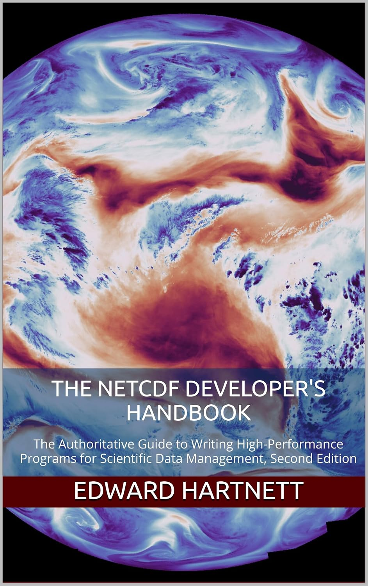
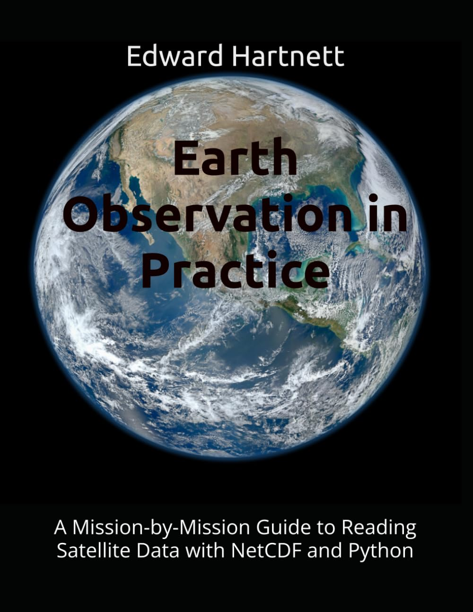

@mainpage nep-compress

# What is nep-compress?

nep-compress provides LZ4 and BZIP2 compression filters for
NetCDF-4/HDF5, with C and optional Fortran wrapper APIs. It is being
separated from [NEP](https://github.com/Intelligent-Data-Design-Inc/NEP)
to make compression easier to build and use without installing NEP's
format readers. NEP remains the project for UDF formats and NEXTCDF-4.

nep-compress builds the LZ4 HDF5 plugin (`libh5lz4`, filter ID 32004)
itself. For BZIP2 (filter ID 307) it builds the Fortran API but
requires an external HDF5 plugin that provides ID 307 for both writing
and reading; the C functions are NetCDF-C's own. For JPEG-LS (filter
ID 32018), the EUMETSAT FCIDECOMP filter used for Meteosat FCI
imagery, nep-compress provides the C and Fortran API and likewise
requires an external plugin.

# Provided filters

The C API is declared in nep_compress.h:

- nc_def_var_lz4(), nc_inq_var_lz4() — LZ4, filter ID 32004 (#LZ4_ID).
- `nc_def_var_bzip2`, `nc_inq_var_bzip2` — BZIP2, filter ID 307
  (#BZIP2_ID); these are NetCDF-C's functions, declared in
  `netcdf_filter.h`.
- nc_def_var_jpegls(), nc_inq_var_jpegls() — JPEG-LS, filter ID 32018
  (#JPEGLS_ID).

The Fortran module `nep_compress` provides the equivalents
nf90_def_var_lz4(), nf90_inq_var_lz4(), nf90_def_var_bzip2(),
nf90_inq_var_bzip2(), nf90_def_var_jpegls(), and
nf90_inq_var_jpegls().

The LZ4 filter plugin itself is implemented in H5Zlz4.c. Its on-disk
chunk encoding is described in
@ref md_plugins_2LZ4__HDF5__format "the LZ4 HDF5 format page".
See the @ref md_docs_2compression "compression guide" for usage and
file-compatibility details.

# NetCDF-4 compression filter comparison

NetCDF-4 variables are compressed through HDF5 filters applied to
chunked storage. The filters available to NetCDF-4 users:

| Filter | HDF5 ID | Provided by | Plugin required | API call | Parameters / levels | Typical trade-off | Lossless |
| --- | --- | --- | --- | --- | --- | --- | --- |
| deflate (zlib) | 1 | Built into HDF5 | No | `nc_def_var_deflate(ncid, varid, shuffle, deflate, level)` | level 1-9 (0 = no compression); the same call's shuffle argument controls shuffle | Balance of speed and ratio; universally readable | Yes |
| szip | 4 | HDF5 built with libaec/szip | No (when HDF5 has szip) | `nc_def_var_szip(ncid, varid, options_mask, pixels_per_block)` | `NC_SZIP_NN` or `NC_SZIP_EC`; pixels_per_block even and <= 32 | Good on integer/telemetry-like data; cannot be combined with deflate | Yes |
| zstandard | 32015 | NetCDF-C plugin `lib__nch5zstd` | Yes | `nc_def_var_zstandard(ncid, varid, level)` | levels -131072 to 22 | Wide range from fast to high ratio | Yes |
| bzip2 | 307 | External HDF5 plugin (NetCDF-C ships `lib__nch5bzip2`; other providers exist) | Yes | `nc_def_var_bzip2(ncid, varid, level)` (NetCDF-C) | level 1-9 (block size 100-900 KB) | Favors ratio over speed | Yes |
| LZ4 | 32004 | nep-compress plugin `libh5lz4` | Yes | `nc_def_var_lz4(ncid, varid, level)` | level 1-9 (acceleration parameter) | Favors speed | Yes |
| JPEG-LS | 32018 | External EUMETSAT fcidecomp plugin (also in hdf5plugin) | Yes | `nc_def_var_jpegls(ncid, varid, near)` | near 0 (lossless) or 1-127 / 1-255; 8/16-bit integer types, rank 2-3 | Strong on integer imagery; used for Meteosat FCI L1c | Yes when near = 0; lossy when near > 0 |

Note that `nc_def_var_zstandard()` does nothing when NetCDF-C was built
without zstd; check `NC_HAS_ZSTD` or `nc-config --has-zstd` before
relying on it.

## Pre-filters and checksums

These HDF5 pipeline entries are not compressors but change the result:

- **shuffle** (ID 2) reorders bytes so the significant bytes of each
  element are grouped together, usually improving the ratio of the
  compressor that follows it. It is enabled through the shuffle argument
  of `nc_def_var_deflate()`.
- **quantize** (`nc_def_var_quantize()`) is a *lossy* step that zeroes
  low-order mantissa bits (`NC_QUANTIZE_BITGROOM`,
  `NC_QUANTIZE_GRANULARBR`, or `NC_QUANTIZE_BITROUND`), improving the
  compression achieved by a subsequent lossless filter.
- **fletcher32** (ID 3) is a checksum filter, not compression.

## Choosing a filter

- For speed, especially write or read throughput, use **LZ4**.
- For the smallest files, use **BZIP2** or a high **zstandard** level.
- For maximum portability — a file any NetCDF-4 reader can open with no
  extra software — use **deflate**, which is built into HDF5.
- For 8- and 16-bit integer imagery, and to write or match EUMETSAT FCI
  files, use **JPEG-LS**. It is not measured by
  `perf_compare_filters`, because that test's fields are float.

Measured guidance on real data is in
@ref which_compression "Which compression should I use?" below.

Every filter other than deflate and szip requires the HDF5 plugin that
implements it to be present on `HDF5_PLUGIN_PATH`, both when writing and
when a reader later opens the file.

The [performance examples](https://github.com/captainkirk99/nep-compress/blob/main/examples/performance/README.md)
contain historical LZ4 and BZIP2 measurements
([lz4_results.csv](https://github.com/captainkirk99/nep-compress/blob/main/examples/performance/lz4_results.csv),
[bzip2_results.csv](https://github.com/captainkirk99/nep-compress/blob/main/examples/performance/bzip2_results.csv)).

## Measured comparison

The `perf_compare_filters` test rewrote four fields from a real GDAS
surface file with every lossless filter, each with the shuffle filter
off and on, on one development machine (see
[reference_machine.txt](https://github.com/captainkirk99/nep-compress/blob/main/performance/reference_machine.txt);
full CSV in
[reference_results.csv](https://github.com/captainkirk99/nep-compress/blob/main/performance/reference_results.csv);
see the [performance README](https://github.com/captainkirk99/nep-compress/blob/main/performance/README.md)).
The table below shows the shuffle-on rows for two of the fields:
`tmp2m` (smooth 2 m temperature) and `prate_ave` (noisy precipitation
rate).

| Filter | Level | tmp2m ratio | tmp2m write MB/s | tmp2m read MB/s | prate_ave ratio | prate_ave write MB/s | prate_ave read MB/s |
| --- | --- | --- | --- | --- | --- | --- | --- |
| none | 0 | 1.00 | 259 | 721 | 1.00 | 367 | 1188 |
| deflate | 1 | 1.88 | 63 | 356 | 1.40 | 51 | 254 |
| deflate | 5 | 1.90 | 54 | 358 | 1.44 | 39 | 263 |
| deflate | 9 | 1.92 | 14 | 380 | 1.45 | 5 | 275 |
| szip | 32 | 1.83 | 108 | 144 | 1.15 | 91 | 100 |
| zstd | 1 | 1.87 | 254 | 788 | 1.42 | 177 | 702 |
| zstd | 3 | 1.88 | 219 | 700 | 1.43 | 103 | 795 |
| zstd | 9 | 1.91 | 89 | 790 | 1.45 | 44 | 574 |
| zstd | 19 | 1.98 | 7 | 826 | 1.48 | 5 | 698 |
| bzip2 | 1 | 2.07 | 17 | 38 | 1.48 | 13 | 28 |
| bzip2 | 9 | 2.06 | 16 | 31 | 1.48 | 12 | 23 |
| lz4 | 1 | 1.76 | 328 | 1101 | 1.31 | 258 | 953 |
| lz4 | 9 | 1.76 | 342 | 1103 | 1.27 | 294 | 988 |

## Performance graphs

The graphs below plot the same reference run (all four fields, all
filters). They were drawn from `reference_results.csv` by
`performance/plot_compare_filters.py`; run that script on your own
`compare_filters.csv` to get the same graphs for your machine.

**How the measurements were made.** Each field is one 1 x 768 x 1536
`NC_FLOAT` array (4,718,592 bytes uncompressed), written as a single
chunk to a new NetCDF-4 file with fill turned off. *Write throughput*
is the uncompressed field size divided by the time from `nc_create()`
to `nc_close()` (define the variable and its filters, `nc_enddef()`,
`nc_put_var_float()`, close). *Read throughput* is the uncompressed
size divided by the time from `nc_open()` to `nc_close()` (find the
variable, `nc_get_var_float()`, close). Both include file open, close
and metadata costs, not just the compressor. Each setting was run three
times and the fastest time is used. *Compression ratio* is the
uncompressed field size divided by the size of the whole file on disk,
so the "none" points sit just below 1.0 (the file carries a few KB of
HDF5 metadata). Every run was read back and checked bit-for-bit against
the original; all filters here are lossless.

**The four fields** come from a NOAA GFS/GDAS surface forecast file:

- `tmp2m`: 2 m air temperature. A smooth, continuous field; typical
  of most model output.
- `prate_ave`: average precipitation rate. Noisy and hard to compress.
- `soilw1`: top-layer soil moisture. Defined over land only, with the
  fill value over the ocean.
- `land`: the land/sea mask. A few repeated categorical values, so it
  compresses very well.

**How to read the graphs.** Each graph has one panel per field. The x
axis is throughput in MB/s on a logarithmic scale; further right is
faster. The y axis is the compression ratio; higher is smaller files.
The y axis is linear, except for `land`, whose ratios span 1 to about
170 and use a logarithmic scale. The best filters for a field are
toward the top right of its panel. Each filter has its own colour and
marker shape (grey circle = none, blue square = deflate, green triangle
= szip, orange diamond = zstd, purple downward triangle = bzip2, red
plus = LZ4). The small numbers next to the points are the filter
levels (for szip, the 32 pixels per block).

### Simple performance graphs

@image html compare_filters_write_simple.png "Figure 1. Compression ratio vs write throughput, fastest level of each filter, shuffle on." width=100%

@image html compare_filters_read_simple.png "Figure 2. Compression ratio vs read throughput, fastest level of each filter, shuffle on." width=100%

*Figures 1 and 2* show one setting per filter so the filters can be
compared directly. For each filter, the level with the highest write
throughput averaged over the four fields was chosen, and the same level
is used in every panel and in both figures: deflate 1, zstd 1, bzip2 1,
LZ4 9 (LZ4's level is an acceleration setting, so 9 is slightly faster
than 1 here) and szip with 32 pixels per block (its only setting). The
shuffle filter is on for every point, including "none", where shuffle
alone does no compression but still costs time. Figure 1 plots the
write throughput and Figure 2 the read throughput of exactly the same
runs, so each point has the same height in both figures.

### Complex performance graphs

@image html compare_filters_write.png "Figure 3. Compression ratio vs write throughput, every filter and level, shuffle off and on." width=100%

@image html compare_filters_read.png "Figure 4. Compression ratio vs read throughput, every filter and level, shuffle off and on." width=100%

*Figures 3 and 4* show every setting that was measured: none, deflate
levels 1, 5 and 9, szip, zstd levels 1, 3, 9 and 19, bzip2 levels 1
and 9, and LZ4 levels 1 and 9, each with the shuffle filter off and on.
Filled markers have shuffle on; open markers have shuffle off. Points
for the same filter and shuffle setting are joined in level order (solid
line = shuffle on, dashed line = shuffle off), so each line shows what
raising the level costs in speed and gains in ratio. Level numbers are
printed next to the shuffle-on points only. Figure 3 plots write
throughput and Figure 4 read throughput for the same runs.

## Which compression should I use? {#which_compression}

These results come from one machine and one data set, and your data
may behave differently. They still support some clear conclusions.

- **Turn on shuffle for continuous floating-point fields.** On `tmp2m`
  shuffle raised the ratio of every compressor except szip by 35-45%
  (deflate 1: 1.34 to 1.88; zstd 1: 1.29 to 1.87). LZ4 did not compress
  `tmp2m` at all without shuffle (1.00) but reached 1.76 with it. On
  `prate_ave` the gain was 10-18%.
- **Try shuffle off for masks, categorical fields and mostly-fill
  fields.** On `land`, shuffle lowered the ratio of deflate, zstd, szip,
  LZ4 and bzip2 (zstd 1: 115 without shuffle, 88 with), and on `soilw1`
  it lowered deflate, zstd and szip. It also slows down the fastest
  filters.
- **zstd level 1 with shuffle is the best general choice when every
  reader has the zstd plugin.** It matched deflate 1's ratio (1.87 vs
  1.88 on `tmp2m`, 1.42 vs 1.40 on `prate_ave`) while writing about 4
  times faster (254 vs 63 MB/s on `tmp2m`) and reading 2 to 3 times
  faster (788 vs 356 MB/s).
- **Use deflate level 1 with shuffle when portability matters most.**
  Deflate is built into every HDF5 library, so any NetCDF-4 reader can
  open the file with no plugin. Higher deflate levels are rarely worth
  it: on `tmp2m`, level 9 gained 2% in ratio (1.92 vs 1.88) but wrote
  4.5 times slower.
- **Use LZ4 with shuffle when speed matters more than size**, for
  example scratch files, checkpoints or data that is read many times.
  It was the fastest filter for both writing and reading in every
  field, at a ratio about 6% below zstd 1 on `tmp2m` and 8-11% below on
  `prate_ave`. Readers need the nep-compress LZ4 plugin.
- **For the smallest archive files, use zstd level 19 with shuffle.** It
  writes slowly (7 MB/s on `tmp2m`) but reads as fast as zstd 1, which
  suits data that is written once and read often. bzip2 gave the
  highest ratio on `tmp2m` (2.07 vs 1.98) and tied on `prate_ave`, but
  it read at only 23-38 MB/s, 20-25 times slower than zstd. Choose it
  only when size matters far more than read time.
- **Do not combine szip with shuffle.** Shuffle lowered szip's ratio on
  every field (`tmp2m` 2.03 to 1.83, `prate_ave` 1.27 to 1.15, `soilw1`
  4.70 to 3.24, `land` 18.1 to 7.75). Without shuffle, szip
  did well on the smooth `tmp2m` field (2.03, second only to bzip2) but
  poorly on the other fields.
- **Check on your own data.** Build with `NEPCOMPRESS_ZSTD_PLUGIN_DIR`
  set, point `compare_filters` at a file of your own fields (it expects
  the four variable names above, so adapt `FIELDS` as needed), and
  plot the CSV with `plot_compare_filters.py`.

# Books

<table><tr>
<td></td>
<td></td>
</tr></table>

- [The NetCDF Developer's Handbook: The Authoritative Guide to Writing
  High-Performance Programs for Scientific Data Management, Second
  Edition](https://www.amazon.com/dp/B0H7Q49MPS) — the complete NetCDF-C
  and NetCDF-Fortran reference, including compression filters, chunking
  and quantization.
- [Earth Observation in Practice: A Mission-by-Mission Guide to Reading
  Satellite Data with NetCDF and
  Python](https://www.amazon.com/dp/B0HJRZ9F7L) — a mission-by-mission
  guide to the spacecraft, instruments and data products of modern
  remote sensing.

# Author

Edward Hartnett, Intelligent Data Design, Inc.
