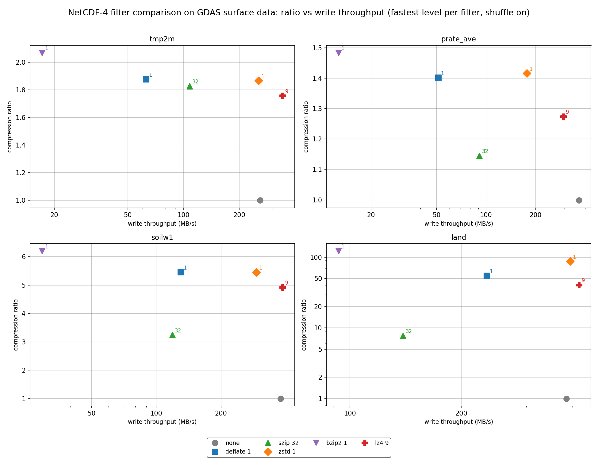
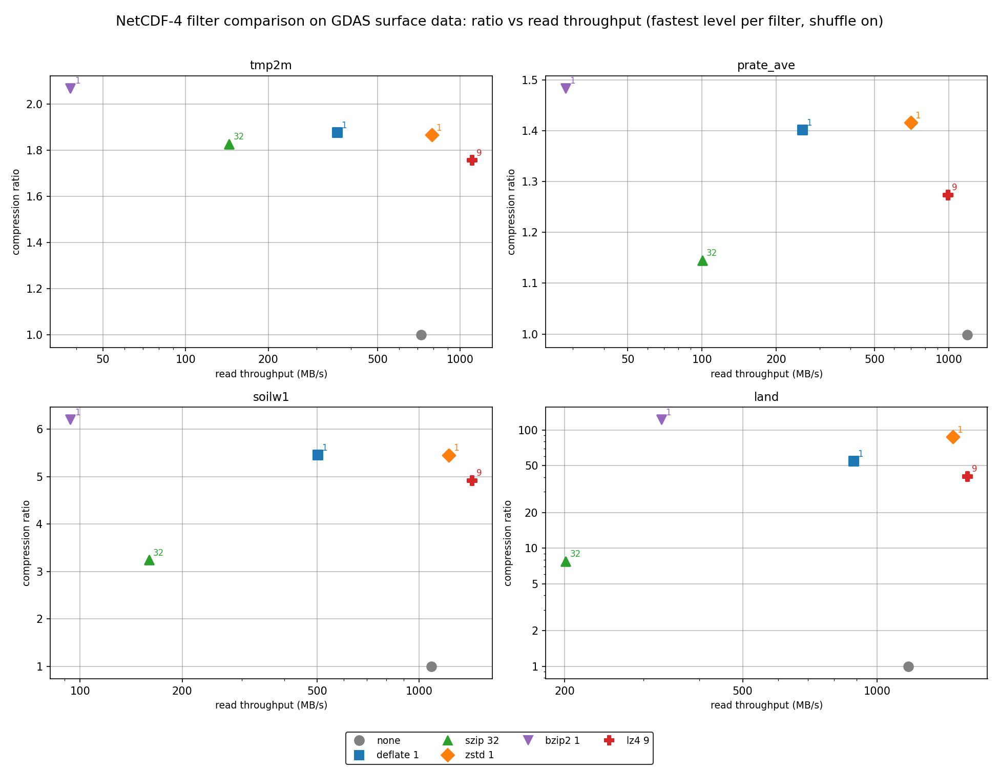

# nep-compress: Fast and Specialized Compression Filters for NetCDF-4

Edward Hartnett, Intelligent Data Design, Inc.

Version 1.2.0, October 2026

# Abstract

nep-compress adds HDF5 filter support for NetCDF-C and
NetCDF-Fortran: the LZ4 compression filter (HDF5 filter ID 32004),
whose plugin is built and installed by nep-compress; Fortran wrappers
for NetCDF-C's BZIP2 functions (ID 307); and C and Fortran functions
for EUMETSAT's JPEG-LS filter (ID 32018), the compression used for
Meteosat Third Generation FCI Level-1c imagery, supplied by the
external fcidecomp plugin. All filters follow the standard
`nc_def_var_*`/`nc_inq_var_*` convention, and HDF5 loads the plugins
at run time, so existing applications read the compressed files
without modification. A benchmark rewrites four real GDAS surface fields with
every lossless NetCDF-4 filter and measures compression ratio and
write/read throughput end to end. In the reference run, LZ4 with
shuffle was the fastest writer and reader of the compressors in every
field at the plotted, shuffle-on settings, and zstd level 1 with
shuffle matched deflate's compression ratio at 1.7 to 4 times its
write speed. nep-compress builds with CMake, installs through Spack
or conda, and is released as open source under the MIT license.

# Introduction

The netCDF C library (NetCDF-C) is maintained by NSF Unidata/UCAR and
is the base of many scientific and operational workflows. It is free
and open source.

NetCDF-C has long supported deflate and szip compression; version
4.9.0 added zstd and bzip2, and the quantize feature provides lossy
compression.

nep-compress expands NetCDF-4 compression by adding:

* the LZ4 filter (HDF5 filter ID 32004): a C and Fortran API plus the
  `libh5lz4` plugin, built by nep-compress.
* the Fortran API for BZIP2 (ID 307): `nf90_def_var_bzip2` and
  `nf90_inq_var_bzip2` wrappers around NetCDF-C's C functions, for use
  with an external BZIP2 plugin.
* the JPEG-LS filter (ID 32018): a C and Fortran API for EUMETSAT's
  FCIDECOMP filter, used for Meteosat Third Generation FCI Level-1c
  imagery.
* the `perf_compare_filters` benchmark, which compares every
  available lossless filter on real Earth science fields.

nep-compress was split out of the [NetCDF Expansion Pack
(NEP)](https://github.com/Intelligent-Data-Design-Inc/NEP) so that
compression can be built and used without NEP's format readers.

nep-compress is free and open source, maintained by the author at
Intelligent Data Design, Inc.

The current version of nep-compress is 1.2.0 (October 2026). It
requires CMake 3.18+, a C compiler, pkg-config, NetCDF-C 4.10.0+
(4.10.1+ for the `perf_compare_filters` test), HDF5 1.14+ with C/HL
libraries, and liblz4 when LZ4 is enabled. The optional Fortran
wrappers require a Fortran compiler and NetCDF-Fortran from the same
NetCDF-C/HDF5 installation. BZIP2 and JPEG-LS each require an
external HDF5 plugin.

nep-compress builds with CMake and can be installed with Spack or
conda. Complete and up-to-date build instructions can be found in the
README.

# Compression

Compression filters in NetCDF-4 are HDF5 filters applied to the
chunked storage of a variable. HDF5 finds the plugins at run time
through `HDF5_PLUGIN_PATH` (or HDF5's default plugin directory, as in
conda builds). Readers of a compressed file need the same plugin as
the writer, and there must be exactly one provider per filter ID on
the plugin path.

## Filters built into NetCDF-C

NetCDF-C gives NetCDF-4 users deflate (zlib, built into HDF5 and so
universally readable), szip, zstd and bzip2, plus the shuffle filter
as a pre-filter that reorders bytes to help the compressors on
multi-byte data. nep-compress adds LZ4 and JPEG-LS:

| Filter | HDF5 ID | Provided by | API call |
| --- | --- | --- | --- |
| deflate (zlib) | 1 | Built into HDF5 | `nc_def_var_deflate(ncid, varid, shuffle, deflate, level)` |
| szip | 4 | HDF5 built with libaec/szip | `nc_def_var_szip(ncid, varid, options_mask, pixels_per_block)` |
| zstandard | 32015 | NetCDF-C plugin `lib__nch5zstd` | `nc_def_var_zstandard(ncid, varid, level)` |
| bzip2 | 307 | External HDF5 plugin (NetCDF-C ships `lib__nch5bzip2`) | `nc_def_var_bzip2(ncid, varid, level)` |
| LZ4 | 32004 | nep-compress plugin `libh5lz4` | `nc_def_var_lz4(ncid, varid, level)` |
| JPEG-LS | 32018 | External EUMETSAT fcidecomp plugin (also in hdf5plugin) | `nc_def_var_jpegls(ncid, varid, near)` |

## LZ4 - Speed First

LZ4 is a lossless compression algorithm from the LZ77 family that
trades maximum compression ratio for very high throughput.
nep-compress builds the HDF5 plugin `libh5lz4` and exposes the filter
through `nc_def_var_lz4(ncid, varid, level)` and
`nc_inq_var_lz4()`, with Fortran equivalents `nf90_def_var_lz4` and
`nf90_inq_var_lz4`. Levels run from 1 to 9; the parameter is an
acceleration setting in the copied LZ4 implementation, so level 9 is
slightly faster than level 1.

For best results on multi-byte data, enable the shuffle filter first
with `nc_def_var_deflate(ncid, varid, 1, 0, 0)`, then call
`nc_def_var_lz4()`. `nc_def_var_lz4` returns `NC_ENOFILTER` if the
LZ4 plugin cannot be loaded.

```c
#include <nep_compress.h>
/* After defining a variable in an NC_NETCDF4 file: */
int status = nc_def_var_lz4(ncid, varid, 3);
int has_filter = 0, level = 0;
if (status == NC_NOERR)
    status = nc_inq_var_lz4(ncid, varid, &has_filter, &level);
```

## BZIP2 - Size First

BZIP2 uses the Burrows-Wheeler block-sorting algorithm to reach
higher compression ratios than deflate, zstd or LZ4, at much lower
speed. The C functions `nc_def_var_bzip2` and `nc_inq_var_bzip2` are
NetCDF-C's own (available since NetCDF-C 4.9.0); nep-compress adds
the Fortran wrappers `nf90_def_var_bzip2` and `nf90_inq_var_bzip2`,
the `NEPCOMPRESS_BUILD_BZIP2` build option and the BZIP2 tests.
Levels 1-9 select the 100-900 KB block size.

BZIP2 needs an external HDF5 plugin for ID 307, such as NetCDF-C's
own `lib__nch5bzip2`; installing `libbz2` alone is not enough.

## JPEG-LS - Meteosat Imagery

EUMETSAT's Meteosat Third Generation FCI Level-1c imagery is
disseminated with JPEG-LS compression through the FCIDECOMP HDF5
filter (ID 32018).

From [*Earth Observation in Practice: A Mission-by-Mission Guide to Reading Satellite Data with NetCDF and Python*](https://www.amazon.com/dp/B0HJRZ9F7L), by Edward Hartnett:

> EUMETSAT disseminates FCI Level-1c imagery with stronger lossless compression based on the JPEG-LS standard through the CharLS library. JPEG-LS is implemented as a custom HDF5 filter (`H5ZJPEGLS`), not built into standard NetCDF-4 or HDF5 installations. The filename's `special_compression` field identifies these datasets; the product user guide documents which streams and dissemination paths use JPEG-LS.
>
> To read JPEG-LS-compressed FCI NetCDF-4 files you must install the `fcidecomp` decompression software from EUMETSAT. `fcidecomp` supplies the `H5ZJPEGLS` HDF5 filter plugin, which the HDF5 library loads automatically when the file is opened. Once the plugin is installed, reads are transparent: `netCDF4.Dataset()` or `h5py.File()` behave as if the data were uncompressed. Without the plugin, accessing a compressed variable fails because the library does not recognise the filter.

nep-compress exposes the filter through
`nc_def_var_jpegls(ncid, varid, near)` and
`nc_inq_var_jpegls()`, with Fortran equivalents. With `near = 0` the
compression is lossless; `near > 0` selects JPEG-LS near-lossless
mode, which is lossy. The variable must be of type `NC_BYTE`,
`NC_UBYTE`, `NC_SHORT` or `NC_USHORT` and rank 2 or 3. Define-time
validation rejects the types, ranks and chunk shapes the plugin
cannot handle, so data is never silently stored uncompressed.
`nc_inq_var_jpegls` reads the 13-parameter form the plugin stores in
FCI files.

nep-compress does not build a JPEG-LS plugin; the external fcidecomp
or hdf5plugin provider does the compression. JPEG-LS is not part of
the benchmark below, because the benchmark fields are floating-point.

# Compression Performance

## Method

The `perf_compare_filters` test rewrites four fields from a NOAA
GFS/GDAS surface forecast file with every available lossless filter:

- `tmp2m`: 2 m air temperature. A smooth, continuous field; typical
  of most model output.
- `prate_ave`: average precipitation rate. Noisy and hard to
  compress.
- `soilw1`: top-layer soil moisture. Defined over land only, with
  the fill value over the ocean.
- `land`: the land/sea mask. A few repeated categorical values, so
  it compresses very well.

Each field is one 1 x 768 x 1536 `NC_FLOAT` array (4,718,592 bytes
uncompressed), written as a single chunk to a new NetCDF-4 file with
fill turned off. Write throughput is the uncompressed field size
divided by the time from `nc_create()` to `nc_close()`; read
throughput is the uncompressed size divided by the time from
`nc_open()` to `nc_close()`. Both include file open, close and
metadata costs, not just the compressor. Each setting was run three
times and the fastest time is used. The compression ratio is the
uncompressed field size divided by the size of the whole file on
disk, so the "none" points sit just below 1.0. Every run was read
back and checked bit-for-bit; all filters measured are lossless.

The reference run was made on 2026-10-26 on an Intel Core i7-6800K at
3.40 GHz (12 cores) running Linux 6.8.0-137, with gcc 13.3.0, netCDF
4.10.2-development and HDF5 2.1.1. To measure your own data on your
own machine, see `performance/README.md`.

## Reference Results

Shuffle on, the level plotted in Figures 1 and 2. Ratio / write MB/s
/ read MB/s.

| Filter | Level | tmp2m | prate_ave | soilw1 | land |
| --- | --- | --- | --- | --- | --- |
| none | - | 1.00 / 259 / 721 | 1.00 / 367 / 1188 | 1.00 / 379 / 1086 | 1.00 / 385 / 1175 |
| deflate | 1 | 1.88 / 63 / 356 | 1.40 / 51 / 254 | 5.46 / 130 / 502 | 54.67 / 235 / 884 |
| szip | 32 | 1.83 / 108 / 144 | 1.15 / 91 / 100 | 3.24 / 119 / 159 | 7.75 / 139 / 201 |
| zstd | 1 | 1.87 / 254 / 788 | 1.42 / 177 / 702 | 5.45 / 292 / 1224 | 87.62 / 394 / 1475 |
| bzip2 | 1 | 2.07 / 17 / 38 | 1.48 / 13 / 28 | 6.21 / 29 / 94 | 122.99 / 93 / 329 |
| LZ4 | 9 | 1.76 / 342 / 1103 | 1.27 / 294 / 988 | 4.93 / 387 / 1431 | 40.82 / 417 / 1591 |

## Figure 1: Write Throughput



**Figure 1.** Compression ratio versus write throughput, one setting
per filter, shuffle on. Each panel is one field: `tmp2m`,
`prate_ave`, `soilw1` and `land`. The x axis is write throughput in
MB/s on a logarithmic scale; further right is faster. The y axis is
the compression ratio; higher means smaller files. The y axis is
linear, except for `land`, which uses a logarithmic scale. Each
filter has its own colour and marker: grey circle = none, blue
square = deflate, green triangle = szip, orange diamond = zstd,
purple downward triangle = bzip2, red plus = LZ4. For each filter
the level with the highest write throughput averaged over the four
fields was chosen: deflate 1, zstd 1, bzip2 1, LZ4 9 and szip with
32 pixels per block. Top right is best.

LZ4 is the rightmost compressor in every panel. zstd 1 sits level
with or above deflate 1 and well to its right. bzip2 1 is the
highest point and the leftmost in every panel. szip is lowest among
the compressors on `prate_ave`, `soilw1` and `land`. On `land` the
spread in ratio is about 3x, from LZ4's 40.82 to bzip2's 122.99.

## Figure 2: Read Throughput



**Figure 2.** Compression ratio versus read throughput for the same
runs as Figure 1, so each point has the same height in both figures
and only the x positions move. Axes, panels and markers are the
same as in Figure 1. Reads are faster than writes for every
compressor.

LZ4 is again the rightmost compressor in every panel, with zstd 1
close behind (702-1475 MB/s). bzip2 reads at 28-329 MB/s, the
slowest in three panels; on `land`, szip is slower still (201 vs
329 MB/s). szip reads slower than deflate in every field.

## Conclusions

- **General use:** zstd level 1 with shuffle. It matched deflate 1's
  ratio within 0.02 on `tmp2m`, `prate_ave` and `soilw1`, and beat
  it on `land` (87.62 vs 54.67), while writing 1.7-4.0 times faster
  (394 vs 235 MB/s on `land`, 254 vs 63 MB/s on `tmp2m`) and
  reading 1.7-2.8 times faster. All readers need the zstd plugin.
- **Portability:** deflate level 1 with shuffle. It is the only
  compressor here that is built into every HDF5 library, so any
  NetCDF-4 reader can open the file with no plugin.
- **Speed:** LZ4 with shuffle was the fastest writer and reader of
  the plotted compressors in every field. Its ratio is 6% (`tmp2m`),
  10% (`prate_ave`), 10% (`soilw1`) and 53% (`land`) below zstd 1's.
  On `tmp2m`, `soilw1` and `land` it even wrote and read faster than
  the shuffle-only "none" point (`tmp2m` 342 vs 259 MB/s write),
  because less data reaches disk; on `prate_ave`, which barely
  compresses, it was slower (294 vs 367 MB/s write, 988 vs 1188 MB/s
  read). Writing with no filters at all is still faster (`tmp2m`
  938 MB/s). LZ4 suits scratch files, checkpoints and data that is
  read many times.
- **Smallest files:** bzip2 1 had the highest ratio in every field,
  but wrote at 13-93 MB/s and read at 28-329 MB/s. zstd level 19
  with shuffle (`tmp2m` ratio 1.98, written at 7 MB/s, read at
  826 MB/s) is the better archive choice when the data is read
  often.
- **Shuffle:** it helps continuous float fields. Without it, LZ4 did
  not compress `tmp2m` at all (ratio 0.998 vs 1.76 with shuffle). It
  hurts szip on every field, and hurts most filters on `land`. The
  charts and table above show shuffle on only; see the documentation
  for the full shuffle-off comparison.
- **Integer imagery:** for 8- and 16-bit integer data such as
  Meteosat FCI imagery, use JPEG-LS; it was not measured here.
- **Caveat:** these results come from one machine and one data set.
  Re-run `perf_compare_filters` on your own data before choosing.

# Building and Installing

nep-compress builds with CMake 3.18+. The main build options and
cache paths, with their defaults, are:

| CMake option | Default | Effect |
| --- | --- | --- |
| `NEPCOMPRESS_BUILD_LZ4` | ON | Build LZ4 API and plugin |
| `NEPCOMPRESS_BUILD_BZIP2` | OFF | Build the Fortran BZIP2 API and tests (requires an external ID 307 plugin) |
| `NEPCOMPRESS_BUILD_JPEGLS` | OFF | Build the JPEG-LS (ID 32018) API and tests (requires an external plugin) |
| `NEPCOMPRESS_ENABLE_FORTRAN` | ON | Build Fortran wrappers and module |
| `NEPCOMPRESS_BZIP2_PLUGIN_DIR` | empty | Directory to probe for the BZIP2 plugin |
| `NEPCOMPRESS_JPEGLS_PLUGIN_DIR` | empty | Directory to probe for the JPEG-LS plugin |
| `NEPCOMPRESS_ZSTD_PLUGIN_DIR` | empty | zstd plugin directory; enables `perf_compare_filters` |

With Spack, the `nep-compress` package is being submitted to
spack/spack-packages; until it is available there, install from the
overlay repository in this repo:

```sh
spack repo add spack/repos/spack_repo/nepcompress
spack install nep-compress
```

The Spack package has variants `lz4`, `bzip2` and `fortran`, all on
by default.

With conda, the linux-64 `nep-compress` recipe is being submitted to
conda-forge; until the feedstock exists, build the recipe in
`conda/recipe/` locally. The conda package installs the LZ4 plugin
in HDF5's default plugin directory as
`lib/hdf5/plugin/libh5lz4_nepcompress.so`, so no `HDF5_PLUGIN_PATH`
is needed.

Full instructions are in the README.

# Summary

nep-compress extends NetCDF-4 compression with:

* LZ4 (ID 32004), the fastest lossless compressor measured, with its
  plugin built by nep-compress.
* the Fortran API for NetCDF-C's BZIP2 filter (ID 307).
* JPEG-LS (ID 32018), the EUMETSAT FCIDECOMP filter used for
  Meteosat Third Generation FCI Level-1c imagery.
* measured guidance on which compression to use, from the
  `perf_compare_filters` benchmark on real GDAS fields.
* builds with CMake, and packages for Spack and conda.

# References

- Hartnett, E. *The NetCDF Developer's Handbook: The Authoritative Guide to Writing High-Performance Programs for Scientific Data Management, Second Edition*. Intelligent Data Design, 2026. https://www.amazon.com/dp/B0H7Q49MPS
- Hartnett, E. *Earth Observation in Practice: A Mission-by-Mission Guide to Reading Satellite Data with NetCDF and Python*. Intelligent Data Design, 2026. https://www.amazon.com/dp/B0HJRZ9F7L
- nep-compress. GitHub repository. https://github.com/captainkirk99/nep-compress
- nep-compress documentation. https://captainkirk99.github.io/nep-compress/
- NEP: NetCDF Expansion Pack. GitHub repository. https://github.com/Intelligent-Data-Design-Inc/NEP
- Unidata/UCAR. *NetCDF-C*. https://www.unidata.ucar.edu/software/netcdf/
- HDF Group. *HDF5*. https://www.hdfgroup.org/solutions/hdf5/
- HDF Group. *HDF5 Filter Plugins*. https://docs.hdfgroup.org/archive/support/HDF5/doc/Advanced/DynamicallyLoadedFilters/index.html
- lz4. *lz4/lz4*. https://github.com/lz4/lz4
- “Bzip2: Home.” https://sourceware.org/bzip2/
- Zstandard. *facebook/zstd*. https://github.com/facebook/zstd
- EUMETSAT. *fcidecomp*. https://gitlab.eumetsat.int/open-source/data-tailor-plugins/fcidecomp
- silx-kit. *hdf5plugin*. https://github.com/silx-kit/hdf5plugin
- CharLS. *team-charls/charls*. https://github.com/team-charls/charls
- Hartnett, Edward, Charles Zender, Ward Fisher, et al. “Quantization and Next-Generation Zlib Compression for Fully Backward-Compatible, Faster, and More Effective Data Compression in NetCDF Files.” Paper presented at AGU, New Orleans, LA, December 13, 2021.
- Hartnett, Edward, and Charlie Zender. “Adding Quantization to the NetCDF C and Fortran Libraries to Enable Lossy Compression.” Paper presented at EGU, May 24, 2022.

Author: Edward Hartnett, Intelligent Data Design, Inc.
